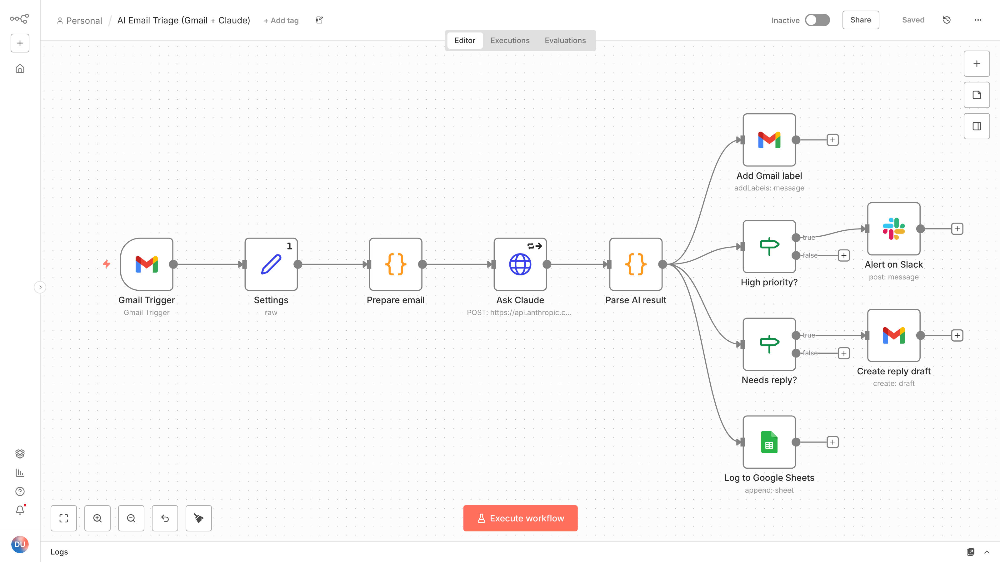

# AI Email Triage for n8n (Gmail + Claude)

[](https://github.com/mick-gsk/n8n-ai-email-triage/actions/workflows/ci.yml)

An n8n workflow that reads every new Gmail message, lets Claude sort it, and then acts on it:
it labels the email, alerts Slack when something is urgent, prepares a reply draft, and logs
everything to Google Sheets. Nothing is sent automatically; replies wait as drafts for a human.



## What happens to each email

1. **Gmail Trigger** picks up unread emails in the inbox (checks every minute).
2. **Prepare email** extracts sender, subject and plain text (HTML is stripped, very long emails are cut to 6,000 characters).
3. **Ask Claude** sends it to the Anthropic API with a strict prompt ([`src/prompt.md`](src/prompt.md)) and gets back JSON:
   category, priority, a one-sentence summary, whether it needs a reply, and a draft reply in the sender's language.
4. **Parse AI result** validates that JSON. Anything malformed, or an API error, becomes category `other`
   with `needs_review = true`, so **no email is ever silently dropped**.
5. Then, in parallel:
   - **Add Gmail label** files it under Support, Sales, Billing, Partnership, Job, Newsletter, Spam or Review.
   - **Alert on Slack** posts high-priority emails (broken service, money at risk, legal or security issues, deadlines within 48 hours).
   - **Create reply draft** puts a suggested answer into the Gmail thread as a draft. The prompt forbids inventing prices, facts or promises.
   - **Log to Google Sheets** keeps one row per email for reporting and spot checks.

## Setup (about 15 minutes)

1. In n8n: **Workflows → Import from file → `workflow.json`**.
2. Create credentials and select them in the nodes:
   - Gmail OAuth2 (Gmail Trigger, Add Gmail label, Create reply draft)
   - Header Auth for Anthropic: name `x-api-key`, value your API key (Ask Claude)
   - Slack and Google Sheets OAuth2 (optional; delete those nodes if you do not need them)
3. Open the **Settings** node and fill in:
   - `labels`: the Gmail label IDs for each category (create the labels in Gmail first; the IDs appear in the
     label dropdown of any Gmail node)
   - `slackChannel` and `sheetId` (the sheet needs a tab named `Log` with the header row `processedAt, from, subject, category, priority, summary, needs_reply, needs_review, error`)
   - `model` if you want a different Claude model
4. Import `error-workflow.json` as well, select the Slack credential and channel in it, and pick it under
   **Workflow settings → Error workflow** of the triage workflow. It posts the failed node, the error and a
   link to the execution if the workflow stops (a Gmail, Slack or Sheets call failing, for example).
   n8n assigns workflow IDs on import, so this link cannot be shipped in the export.
5. Run it once with **Execute workflow**, check the result, then activate it.

To use OpenAI or another provider instead, change the URL, header and request shape in **Ask Claude** and
**Prepare email**; the rest of the workflow stays the same.

## Tests

The Code node logic and the prompt live in `src/` as normal files. `npm run build` writes them into
`workflow.json` and `error-workflow.json`, and the tests run the same code outside n8n with mocked inputs:

```bash
npm test
```

They cover email parsing (plain text, HTML, truncation), the request sent to Claude, validation of the AI
reply (wrapped JSON, unknown categories, API errors), and checks on `workflow.json` itself: every node
reachable, every category has a label, the export in sync with `src/`, and no credentials included.

`npm run lint` runs ESLint and Prettier, `npm run typecheck` checks the Code node sources with
TypeScript (`// @ts-check` and JSDoc, no build step). CI runs all three on Node 20 and 22 and fails if
`workflow.json` was edited by hand or not rebuilt after a change in `src/`.

The workflow was also imported into n8n 1.123 and run end to end with mocked Gmail and Claude steps.

### Measuring the prompt

[`eval/emails.json`](eval/emails.json) holds labelled example emails in English and German.
`ANTHROPIC_API_KEY=... npm run eval` sends them through the real prompt and prints category and
priority accuracy, so prompt changes can be compared before going live.

## Files

| Path | Purpose |
|---|---|
| `workflow.json` | the workflow to import (generated) |
| `error-workflow.json` | error workflow that reports failed runs to Slack (generated) |
| `src/prompt.md` | system prompt for Claude |
| `src/prepare-email.js` | Code node: normalise email, build API request |
| `src/parse-result.js` | Code node: validate the AI reply |
| `src/format-error-alert.js` | Code node of the error workflow: build the Slack message |
| `scripts/build-workflow.mjs` | builds `workflow.json` from `src/` |
| `test/` | unit tests for the Code nodes and structural checks of the workflow |
| `eval/` | labelled emails and an accuracy script |

## License

MIT
