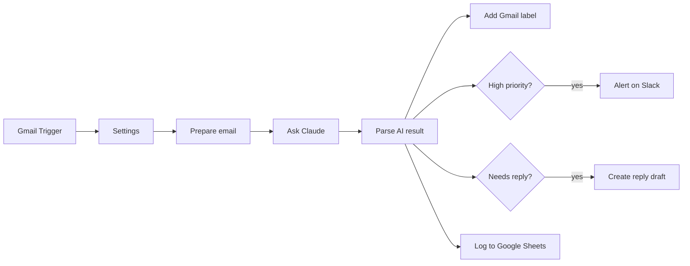

# AI Email Triage for n8n (Gmail + Claude)

[](https://github.com/mick-gsk/n8n-ai-email-triage/actions/workflows/ci.yml)

An n8n workflow that reads every new Gmail message, lets Claude sort it, and then acts on it:
it labels the email, alerts Slack when something is urgent, prepares a reply draft, and logs
everything to Google Sheets. Nothing is sent automatically; replies wait as drafts for a human.


## How it works



1. Gmail Trigger picks up unread emails in the inbox (checks every minute).
2. Prepare email extracts sender, subject and plain text (HTML is stripped, the body is cut to 6,000
   characters) and skips mail that already has one of the triage labels.
3. Ask Claude sends it to the Anthropic API with the prompt in [`src/prompt.md`](src/prompt.md) and gets
   back JSON: category, priority, a one-sentence summary, whether it needs a reply, and a draft reply in
   the sender's language.
4. Parse AI result validates that JSON. Anything malformed, a refusal, or an API error becomes category
   `other` with `needs_review = true`, so no email is silently dropped.
5. Then the email is labelled (Support, Sales, Billing, Partnership, Job, Newsletter, Spam or Review),
   high-priority mail is posted to Slack, a draft is added to the Gmail thread if a reply is needed, and
   one row is appended to the log sheet.

A second, small workflow (`error-workflow.json`) posts to Slack when a run fails outright.

## Setup (about 15 minutes)

1. In n8n: **Workflows → Import from file → `workflow.json`**.
2. Create credentials and select them in the nodes:
   - Gmail OAuth2 (Gmail Trigger, Add Gmail label, Create reply draft)
   - Header Auth for Anthropic: name `x-api-key`, value your API key (Ask Claude)
   - Slack and Google Sheets OAuth2 (optional; delete those nodes if you do not need them)
3. Fill in the Settings node (see [Configuration](#configuration)). Create the Gmail labels first; their
   IDs appear in the label dropdown of any Gmail node.
4. Import `error-workflow.json` as well, select the Slack credential and channel in it, and pick it under
   **Workflow settings → Error workflow** of the triage workflow. n8n assigns workflow IDs on import, so
   this link cannot be shipped in the export.
5. Run it once with **Execute workflow**, check the result, then activate it.

To use OpenAI or another provider instead, change the URL, header and request shape in Ask Claude and
Prepare email; the rest of the workflow stays the same.

## Configuration

Settings node:

| Key | Default | Notes |
|---|---|---|
| `model` | `claude-haiku-5-5` | The request turns thinking off, which Haiku 5.5 accepts. For Opus 5.5 or Sonnet 5.5, remove `thinking` in `src/prepare-email.js` and raise `max_tokens`. |
| `labels` | placeholders | Gmail label ID per category; `other` is the review label. |
| `slackChannel` | `#inbox-alerts` | Channel for high-priority mail. |
| `sheetId` | placeholder | Needs a tab `Log` with the header row `processedAt, from, subject, category, priority, summary, needs_reply, needs_review, error`. |
| `systemPrompt` | `src/prompt.md` | Edit the file and rebuild rather than the node, so tests and eval use the same text. |

Set in the code (`src/`, `scripts/build-workflow.mjs`): body limit 6,000 characters, sender and subject
300, `max_tokens` 700, drafts capped at 2,000 characters, Claude calls batched 5 per second with a 60 s
timeout and up to 4 tries, polling every minute.

## Design decisions

- Drafts, not sent replies. A wrong category costs a click; a wrong answer to a customer costs more.
  The draft is only created when the reply passed validation.
- Emails are untrusted input. The email goes to Claude inside `<email>` tags with any such tags removed
  from its text, and the prompt says instructions in it are not to be followed. The parser does not rely
  on that: it only accepts known categories and priorities, forces spam to low priority, never drafts for
  spam or newsletters, and drops any draft that contains a URL or IBAN, since the model has neither unless
  the email put it there. Sender, subject and summary are escaped in Slack (no `<!channel>` pings) and
  written to Sheets as plain values (no formulas).
- Failures are visible. A failed Claude call becomes a Review item with the API error in the log. Any
  other failure (expired token, wrong label ID) stops the run and the error workflow reports it.

## Running in production

- Cost: input per email is at most about 8,200 characters (1,500 prompt, 600 sender and subject, 6,000
  body) and output at most 700 tokens. Even at a pessimistic 2 characters per token that is under 4,200
  input tokens, so at Haiku 5.5 list prices ($0.10 / $0.50 per million tokens, October 2026) one email
  costs at most about $0.0008. Most emails are far shorter.
- Rate limits: Claude calls go out in batches of 5 per second. A large backlog on first activation is
  not a problem because the trigger only fetches mail received after activation.
- Data: execution logs contain the email text. Set `EXECUTIONS_DATA_SAVE_ON_SUCCESS=none` or prune with
  `EXECUTIONS_DATA_PRUNE=true` and `EXECUTIONS_DATA_MAX_AGE`. Email content is sent to Anthropic, so the
  customer's data processing agreement needs to cover it.
- Credentials: n8n stores them encrypted with `N8N_ENCRYPTION_KEY`; keep that key outside the instance
  backup. The exports here contain no credential IDs (a test checks this).
- Scale: one poll per minute with a handful of emails runs fine in n8n's default mode. Queue mode
  (`EXECUTIONS_MODE=queue` with Redis and workers) is only worth it if the instance runs much else.

## Limits

- Retries: n8n retries a node that continues on error only when the first item of a batch failed, and
  then repeats the whole batch with a fixed 5 s wait. Emails that still fail go to Review rather than
  being retried later.
- If a run stops after Ask Claude (for example a Gmail call fails), the trigger has already moved past
  those emails. The error workflow reports it; the emails have to be labelled by hand or re-run.
- Attachments are ignored and only the first 6,000 characters of the body are read.
- Prompt injection is mitigated, not ruled out: an email can still nudge category or priority. What it
  cannot do is get a link or account number into a draft, or reach Slack or Sheets unescaped.

## Development

```bash
npm ci
npm test            # builds both workflow files, then runs the tests
npm run lint        # ESLint + Prettier
npm run typecheck   # tsc on the Code node sources (// @ts-check + JSDoc)
```

The Code node logic and the prompt live in `src/` as normal files. `npm run build` writes them into
`workflow.json` and `error-workflow.json`; never edit those by hand. The tests run the Code node sources
outside n8n with mocked `$input` and `$()`, and check the exports: every node reachable, every category
has a label, exports in sync with `src/`, no credentials included, retry and escaping settings in place.
CI runs lint, type check and tests on Node 20 and 22 and fails if a rebuilt export differs from the
committed one.

An earlier version of the workflow was imported into n8n 1.123 and run end to end with mocked Gmail
and Claude steps. The node settings added since (retries, timeout, cell format, error workflow) were
checked against the n8n 1.12x node sources.

### Measuring the prompt

[`eval/emails.json`](eval/emails.json) holds 28 labelled emails in English and German, including
prompt-injection attempts and a few that are easy to get wrong. `ANTHROPIC_API_KEY=... npm run eval`
sends them through the real prompt and parser and prints category and priority accuracy, so prompt
changes can be compared before going live.

## Files

| Path | Purpose |
|---|---|
| `workflow.json` | the workflow to import (generated) |
| `error-workflow.json` | error workflow that reports failed runs to Slack (generated) |
| `src/prompt.md` | system prompt for Claude |
| `src/prepare-email.js` | Code node: normalise email, build API request |
| `src/parse-result.js` | Code node: validate the AI reply |
| `src/format-error-alert.js` | Code node of the error workflow: build the Slack message |
| `src/n8n-globals.d.ts` | types for `$input` and `$()`, used by the type check only |
| `scripts/build-workflow.mjs` | builds both workflow files from `src/` |
| `test/` | unit tests for the Code nodes and structural checks of the workflows |
| `eval/` | labelled emails and an accuracy script |

## License

MIT
