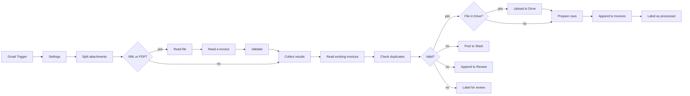

# E-Rechnung for n8n (XRechnung and ZUGFeRD from Gmail to Sheets)

An n8n workflow for small German businesses that receive e-invoices (E-Rechnungen) by email. Since
1 January 2025 every business in Germany has to be able to receive them. The workflow picks up
XRechnung files (XML in UBL or CII syntax) and ZUGFeRD / Factur-X PDFs (a PDF with the CII XML
embedded), reads the invoice data from the XML, checks it, and writes valid invoices to a Google
Sheet, optionally with the original file in a Drive folder. Anything that does not check out (wrong
totals, an invalid IBAN, a duplicate, a PDF without XML, a file that cannot be read) goes to a Slack
channel and a Review tab, with the reason.

There is no AI step and no OCR: every value comes from an XML element, so amounts and dates are
exact. This is a bookkeeping aid, not tax advice, and not a full e-invoice validation (see
[What is not checked](#what-is-not-checked)).

## How it works



1. Gmail Trigger checks every minute for mail matching `label:e-rechnung has:attachment` and
   downloads the attachments (at most 10 emails per poll; the rest come with the next one).
2. Split attachments makes one item per XML or PDF attachment (by MIME type, or by extension when the
   type is `application/octet-stream`). Other files are ignored. A file over the size limit, or an
   email with no XML or PDF at all, becomes a review item.
3. Read e-invoice parses the XML, or for a PDF finds the embedded files and parses the one that is an
   invoice. When an email carries the same invoice twice (ZUGFeRD PDF plus XML, or XRechnung plus a
   PDF copy without XML), it is read once and the copy is dropped.
4. Validate checks the data (see below). Any problem sets the status to `review` with a list of
   reasons.
5. Check duplicates compares valid invoices with the rows in the Invoices tab and with each other:
   same seller (VAT ID, or normalised name) and same invoice number (ignoring case and separators).
   An IBAN that differs from earlier invoices of the same seller is sent to review.
6. Valid invoices: the original file is uploaded to the Drive folder as
   `2026-10-02 Seller name RE-123.xml` (or `.pdf`), a row is appended to the Invoices tab, and the
   email gets the processed label.
7. Everything else: a Slack message with the file name, sender, reasons and a link to the email, a
   row in the Review tab, and the review label on the email.

## Supported formats

| Input | Result |
|---|---|
| XRechnung 3.x, UBL (`Invoice`, `CreditNote`) | read and checked |
| XRechnung 3.x, CII (`CrossIndustryInvoice`) | read and checked |
| Other EN 16931 XML in UBL or CII (Peppol BIS, for example) | read and checked |
| ZUGFeRD 2.x / Factur-X PDF, profiles BASIC, EN 16931 (Comfort), EXTENDED, XRECHNUNG | the embedded XML is read and checked |
| ZUGFeRD MINIMUM and BASIC WL | review: below EN 16931, no line items |
| ZUGFeRD 1.0 (`CrossIndustryDocument`) | review: not EN 16931 |
| PDF without embedded XML | review (dropped if the same email has an e-invoice) |
| Encrypted PDF, unsupported PDF stream filter, malformed XML, XML with a DOCTYPE | review, with the reason |
| ZIP files, images, other attachments | ignored |

## What is checked

| Check | Rule |
|---|---|
| Required fields | Invoice number (BT-1), issue date (BT-2), type code (BT-3), currency (BT-5), specification identifier (BT-24), seller name (BT-27) and country (BT-40), buyer name (BT-44), the totals BT-106, BT-109, BT-112, BT-115, at least one VAT breakdown (BG-23) and one line (BG-25). Seller VAT ID (BT-31) or tax number (BT-32), unless the invoice is outside the scope of VAT (category O only). |
| Amounts | Plain decimals with at most two decimal places; anything else is an error, not rounded. All sums are compared in whole cents, exactly. |
| Sum rules | Lines add up to BT-106 (BR-CO-10); BT-106 − allowances + charges = net BT-109 (BR-CO-13); net + VAT = gross BT-112 (BR-CO-15); gross − prepaid + rounding = amount due BT-115 (BR-CO-16). |
| VAT breakdown | VAT amounts add up to the VAT total (BR-CO-14), taxable amounts to the net total. Per category, VAT differs from basis × rate by less than one currency unit (the EN 16931 tolerance, BR-S-09), and is 0 for categories Z, E, AE, K, G, O. |
| Type code | One of 326, 380, 381, 384, 389, 875, 876, 877 (XRechnung, BR-DE-17). 381 is a credit note and is stored with negative amounts. |
| Dates | Valid calendar dates; issue date not more than a day in the future; due date not before the issue date; a due date or payment terms when an amount is due (BR-CO-25). |
| IBAN | Length per country from the SWIFT IBAN registry and mod-97 checksum, for SEPA transfers (payment means 58) and any account that looks like an IBAN. A SEPA transfer without IBAN goes to review. |
| Duplicates | Same seller and invoice number as a row in the sheet or another invoice in the run. |
| IBAN change | The IBAN differs from earlier invoices of the same seller. |

### What is not checked

The KoSIT validator runs XML Schema validation and several hundred EN 16931 and XRechnung rules
(code lists, conditional fields, line-level calculations, attachments). This workflow checks the
subset above, which covers the amounts and the fields a bookkeeper needs; it does not replace the
validator. Also not checked: whether the invoice is addressed to your business, whether the content
meets every requirement of § 14 UStG for input tax deduction, PDF/A conformance of ZUGFeRD files,
and whether the visual PDF matches the XML (for ZUGFeRD the XML is the invoice).

## Checking against the KoSIT validator

The KoSIT validator with the XRechnung configuration is the reference for XRechnung. To check an
invoice yourself (Java 11 or later):

```bash
curl -LO https://github.com/itplr-kosit/validator/releases/download/v1.6.3/validator-1.6.3-standalone.jar
curl -LO https://github.com/itplr-kosit/validator-configuration-xrechnung/releases/download/v2026-08-31/xrechnung-3.0.2-validator-configuration-2026-08-31.zip
unzip -d xrechnung-config xrechnung-3.0.2-validator-configuration-2026-08-31.zip
java -jar validator-1.6.3-standalone.jar -s xrechnung-config/scenarios.xml -r xrechnung-config -o reports invoice.xml
```

Results with validator 1.6.3 and the configuration of 2026-08-31, on the
[XRechnung test suite](https://github.com/itplr-kosit/xrechnung-testsuite) (commit `1ce1daf`):

- The validator accepts all 86 sample invoices (66 standard, 6 extension, 14 technical cases). The
  workflow accepts 85 of them. `05.01a` (extension with third-party payments, BG-DEX-09) goes to
  review, because its amount due is not gross − prepaid + rounding.
- Broken copies of `01.01a` in UBL and CII (wrong gross total, wrong VAT breakdown, missing invoice
  number, IBAN with a wrong check digit): the validator rejects the first three and accepts the IBAN,
  since EN 16931 has no IBAN checksum rule. The workflow sends all four to review.

14 of the samples are in [`test/fixtures/xrechnung-testsuite`](test/fixtures/xrechnung-testsuite)
(Apache License 2.0) and run in the unit tests, together with the broken copies.

ZUGFeRD PDFs were tried with the 32 sample PDFs in the test resources of the
[Mustang project](https://github.com/ZUGFeRD/mustangproject) (not in this repository). 18 of them
carry a ZUGFeRD 2 / Factur-X invoice in profile EN 16931, EXTENDED or XRECHNUNG; 17 were read and
accepted, one went to review because its sample IBAN has a wrong check digit. ZUGFeRD 1.0, BASIC WL,
PDFs without XML and Order-X files went to review. Some of the accepted files are marked invalid in
Mustang's own tests because of PDF/A or XML schema errors, which this workflow does not check.

## Setup (about 20 minutes)

1. In n8n: **Workflows → Import from file → `workflow.json`**.
2. In Gmail, create the labels `E-Rechnung`, `E-Rechnung processed` and `E-Rechnung review`, and a
   filter that puts the `E-Rechnung` label on incoming invoices (for example everything sent to
   `rechnung@...`). If you use a different label or search, change the query in the Gmail Trigger
   node.
3. Create a Google Sheet with two tabs and these header rows:
   - `Invoices`: `processed_at, format, document_type, type_code, invoice_number, issue_date,
     due_date, seller_name, seller_vat_id, seller_tax_number, seller_address, buyer_name,
     buyer_reference, currency, net_amount, vat_amount, gross_amount, payable_amount, vat_breakdown,
     iban, payment_terms, line_items, file_name, file_link, email_from, email_subject, message_id`
   - `Review`: `processed_at, status, reason, format, seller_name, invoice_number, issue_date,
     currency, gross_amount, file_name, email_from, email_subject, gmail_link, message_id`
4. Optional: create a Drive folder for the files.
5. Create credentials and select them in the nodes:
   - Gmail OAuth2 (Gmail Trigger, Label as processed, Label for review)
   - Google Sheets OAuth2 (Read existing invoices, Append to Invoices, Append to Review)
   - Google Drive OAuth2 (Upload to Drive), if you file in Drive
   - Slack (Post to Slack)
6. Fill in the Settings node (see [Configuration](#configuration)). The Gmail label IDs appear in the
   label dropdown of any Gmail node; the sheet and folder IDs are in their URLs.
7. Import [`shared/error-alert/workflow.json`](../../shared/error-alert/workflow.json), select its Slack
   credential and channel, and pick it under **Workflow settings → Error workflow**.
8. Send yourself a test invoice (the files in `test/fixtures` work), run the workflow once with
   **Execute workflow**, check the sheet, then activate it.

No environment variables are needed. The Code nodes use no modules, so `NODE_FUNCTION_ALLOW_BUILTIN`
and `NODE_FUNCTION_ALLOW_EXTERNAL` can stay unset, and the workflow also runs where they cannot be
set.

## Configuration

Settings node:

| Key | Default | Notes |
|---|---|---|
| `maxFileMB` | `10` | Larger attachments go to review. |
| `processedLabelId`, `reviewLabelId` | placeholders | Gmail label IDs. Mail that already has either label is skipped. |
| `sheetId` | placeholder | The sheet with the `Invoices` and `Review` tabs. |
| `driveFolderId` | placeholder | Folder for the original files. Empty: nothing is stored in Drive and `file_link` stays empty. |
| `slackChannel` | `#bookkeeping` | Channel for review messages. |

Set in the code (`src/`): at most 500 invoice lines read per invoice (more goes to review) and 100
stored in `line_items`, 20 MB limit for an embedded XML after decompression.

## Design decisions

- The XML is the invoice. For a ZUGFeRD PDF only the embedded XML is read; the printed page is not
  compared with it, as it is the XML that counts for an e-invoice.
- No dependencies. n8n's Code node has no XML parser, and zlib (for the compressed streams in PDFs)
  is blocked unless `NODE_FUNCTION_ALLOW_BUILTIN` allows it. Read e-invoice therefore contains a small
  XML reader and a deflate decoder; both are tested against the test suite samples, against Node's
  zlib output at several compression levels, and in n8n 2.43.
- Embedded files are found by scanning the PDF for `/EmbeddedFile` streams, not by following the
  object tree, so PDFs with compressed object streams and broken cross-reference tables still work.
  Every embedded file is tried; the first that is an invoice counts.
- Failures are visible. A file that cannot be read, an email without XML or PDF, and every failed
  check end up in Review with the reason. A failure of Gmail, Sheets or Drive stops the run and the
  error workflow reports it.
- A valid XML file does not make the bank account in it right. A seller's IBAN that differs from its
  earlier invoices goes to review, which is how invoice fraud usually looks. Fields from invoices and
  emails are escaped in Slack and written to Sheets as plain values (`RAW`, no formulas).
- Order of the writes: Drive upload, then the sheet row, then the processed label. If the run stops
  in between, the email is not labelled and the duplicate check prevents a second row when it is
  processed again.

## Running in production

- Data: execution logs contain the files (base64) and the invoice data. Set
  `EXECUTIONS_DATA_SAVE_ON_SUCCESS=none` or prune with `EXECUTIONS_DATA_PRUNE=true` and
  `EXECUTIONS_DATA_MAX_AGE`. Nothing leaves your n8n instance except to Google and Slack.
- Retention: e-invoices have to be kept in their original format (the XML) for the statutory period
  (GoBD). The Drive copy is the original file, but the workflow does not make Drive an archive that
  meets those rules.
- Credentials: n8n stores them encrypted with `N8N_ENCRYPTION_KEY`. The export contains no credential
  IDs (a test checks this).

## Limits

- Not a full validation (see [What is not checked](#what-is-not-checked)). An invoice the workflow
  accepts can still be rejected by the KoSIT validator, for example for a wrong code list value.
- XRechnung extension features that change the totals (third-party payments, BG-DEX-09) go to review.
- Only the first payment means with an account is stored as `iban`.
- E-invoices inside ZIP files, and e-invoices sent by download link or portal instead of as an
  attachment, are not read.
- The duplicate check reads the whole Invoices tab on every run. That is fine for a few thousand rows;
  beyond that, archive old years to another tab.
- The trigger only sees mail received after it was activated. Labelling an old email `E-Rechnung` by
  hand does not process it; use **Execute workflow** for that.
- Paper and plain PDF invoices are still allowed in Germany during the transition period. They go to
  review here; the [invoice extraction](../invoice-extraction) workflow reads them.

## Tests

`npm test` (from the repository root) runs the Code node sources outside n8n with mocked `$input` and
`$()`: the XML reader, UBL and CII mapping (each test suite sample in both syntaxes must give the same
data), ZUGFeRD PDFs built in the test around a sample XML (compressed, uncompressed, indirect stream
length), the deflate decoder, the validation rules with the broken copies, duplicates and IBAN
changes, attachment splitting and the sheet rows. It also checks the export: in sync with `src/`, no
modules in the Code nodes, the review path, optional Drive, `RAW` cell format, Slack escaping.

`npm run check:n8n -- e-rechnung` imports the workflow into n8n 2.43 (Docker) and runs the cases in
[`test/n8n.cases.mjs`](test/n8n.cases.mjs): an XRechnung is filed and written, a ZUGFeRD PDF sent with
its XML is stored once, wrong totals, a duplicate and a plain PDF go to review, and without a Drive
folder the row is written without a link. Gmail, Sheets, Drive and Slack are replaced by nodes that
record what they would have sent.

## Files

| Path | Purpose |
|---|---|
| `workflow.json` | the workflow to import (generated by `build.mjs`) |
| `build.mjs` | builds `workflow.json` from `src/` |
| `src/split-attachments.js` | Code node: one item per XML or PDF attachment |
| `src/read-einvoice.js` | Code node: XML reader, PDF embedded files, UBL and CII mapping |
| `src/validate-einvoice.js` | Code node: the checks, and the record for the sheet |
| `src/check-duplicates.js` | Code node: duplicates and IBAN changes |
| `src/prepare-rows.js` | Code node: rows for the Invoices tab |
| `test/` | unit tests, structural checks, the n8n run cases and the test suite samples |
