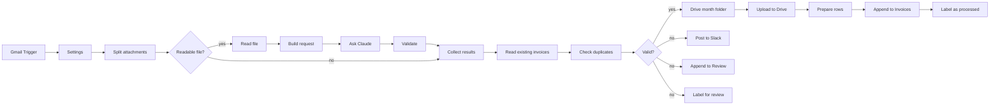

# Invoice extraction for n8n (Gmail + Claude to Sheets and Drive)

An n8n workflow for bookkeeping: it picks up invoices and receipts that arrive by email, lets Claude
read each PDF or photo, checks the result, and files it. A valid invoice becomes a row in a Google
Sheet and its file goes to a Drive folder for its month. Anything that does not check out (wrong
totals, invalid IBAN, a duplicate, a document that is not an invoice, a failed API call) goes to a
Slack channel and a Review tab instead, with the reason.

## How it works

1. Gmail Trigger checks every minute for mail matching `label:invoices has:attachment` and downloads
   the attachments (at most 10 emails per poll; the rest come with the next one).
2. Split attachments makes one item per PDF, JPEG, PNG, WebP or GIF. Other file types and images under
   20 KB (signature logos) are ignored. A file over the size limit, or an email with no usable file at
   all, becomes a review item and skips Claude.
3. Build request sends each file to the Anthropic Messages API as a `document` block (PDF) or `image`
   block, with the prompt in [`src/prompt.md`](src/prompt.md) and the JSON schema in
   [`src/schema.json`](src/schema.json) as structured output. Claude reads scans and photos directly,
   so there is no OCR step. Numbers and dates are copied as printed; the conversion happens in code.
4. Validate turns the reply into a record and checks it (see below). Any problem sets the status to
   `review` with a list of reasons.
5. Check duplicates compares valid invoices with the rows already in the Invoices tab and with each
   other: same supplier (VAT ID, or normalised name) and same invoice number (ignoring case and which
   separator is used: `RE 2026/0042` equals `re-2026-0042`, `INV-12-34` differs from `INV-123-4`).
   Receipts without a number match on supplier, date and total. An IBAN that differs from earlier
   invoices of the same supplier is sent to review.
6. Valid invoices: the file is uploaded to a folder named after the invoice month (`2026-10`, created
   if missing), a row with a link to the file is appended to the Invoices tab, and the email gets the
   processed label.
7. Everything else: a Slack message with the file name, sender, reasons and a link to the email, a
   row in the Review tab, and the review label on the email.

What Validate checks:

| Check | Rule |
|---|---|
| Amounts | Parsed in the document's number format (`1.234,56` or `1,234.56`, also `1'234.56`, `1 234,56`, trailing minus, brackets). An amount that does not fit the format, or is too large to be a number, is an error, not a guess. |
| Totals | net + VAT = gross within 0.02 (compared in whole cents); each VAT line needs a readable rate, and its VAT = net × rate; VAT lines add up to the totals. Invoices and credit notes need all three totals, receipts only gross. |
| Credit notes | Stored with negative amounts, however the document prints them. Mixed signs go to review; so does a negative total on an invoice. |
| Dates | `2.10.2026`, `02.10.26`, `2026-10-02`, `2. Oktober 2026`, `Oct 2, 2026` and similar to ISO. Slash dates follow `dateOrder` unless one part is above 12. Payment terms in days (0 to 365) are stored and, if no due date is printed, become one. Due date before invoice date, or an invoice date in the future, goes to review. |
| IBAN | Length per country from the SWIFT IBAN registry (an unknown country code is invalid) and mod-97 checksum. |
| VAT ID | Format for the EU countries plus CH, GB, NO and Northern Ireland; check digit for German IDs. IDs from other countries are not checked. |
| Required fields | Supplier name, invoice number (not for receipts), invoice date, currency as a current ISO 4217 code. `€`, `£`, `US$`, `SFr` and `Fr.` are converted; symbols shared by several currencies (`$`, `kr`, `¥`) are not and go to review. |
| Uncertain fields | Fields Claude reports as unreadable (blurred, cut off, handwritten) go to review. |

## Setup (about 30 minutes)

1. In n8n: **Workflows → Import from file → `workflow.json`**.
2. In Gmail, create the labels `Invoices`, `Invoice processed` and `Invoice review`, and a filter that
   puts the `Invoices` label on incoming invoices (for example everything sent to `invoices@...`). If
   you use a different label or search, change the query in the Gmail Trigger node.
3. Create a Google Sheet with two tabs and these header rows:
   - `Invoices`: `processed_at, document_type, supplier_name, supplier_vat_id, invoice_number,
     invoice_date, due_date, payment_terms_days, currency, net_amount, vat_amount, gross_amount,
     vat_rates, iban, line_items, file_name, file_link, email_from, email_subject, message_id`
   - `Review`: `processed_at, status, reason, document_type, supplier_name, invoice_number,
     invoice_date, currency, gross_amount, file_name, email_from, email_subject, gmail_link, message_id`
4. Create a Drive folder for the files. The month folders are created inside it.
5. Create credentials and select them in the nodes:
   - Gmail OAuth2 (Gmail Trigger, Label as processed, Label for review)
   - Header Auth for Anthropic: name `x-api-key`, value your API key (Ask Claude)
   - Google Sheets OAuth2 (Read existing invoices, Append to Invoices, Append to Review)
   - Google Drive OAuth2 (Find month folders, Create month folder, Upload to Drive)
   - Slack (Post to Slack)
6. Fill in the Settings node (see [Configuration](#configuration)). The Gmail label IDs appear in the
   label dropdown of any Gmail node; the sheet and folder IDs are in their URLs.
7. Import [`shared/error-alert/workflow.json`](../../shared/error-alert/workflow.json), select its Slack
   credential and channel, and pick it under **Workflow settings → Error workflow**.
8. Send yourself a test invoice, run the workflow once with **Execute workflow**, check the sheet and
   the Drive folder, then activate it.

## Configuration

Settings node:

| Key | Default | Notes |
|---|---|---|
| `model` | `claude-sonnet-5-5` | Any current Claude model that supports PDF input and structured outputs. |
| `effort` | `low` | Sent as `output_config.effort`. Try `medium` if fields are missed on complex layouts. |
| `dateOrder` | `DMY` | How to read `03/04/2026`. `MDY` for US suppliers. |
| `maxPdfMB` | `10` | Larger PDFs go to review. Images are limited to 3.75 MB so their base64 form stays under the API's 5 MB image limit. |
| `minImageKB` | `20` | Smaller images are treated as logos and ignored. |
| `processedLabelId`, `reviewLabelId` | placeholders | Gmail label IDs. Mail that already has either label is skipped. |
| `sheetId` | placeholder | The sheet with the `Invoices` and `Review` tabs. |
| `driveFolderId` | placeholder | Parent folder of the month folders. |
| `slackChannel` | `#bookkeeping` | Channel for review messages. |
| `systemPrompt`, `outputSchema` | `src/` | Edit the files and rebuild rather than the node, so the tests use the same text. |

Set in the code (`src/`, `build.mjs`): `max_tokens` 16,000, Claude calls batched 2 every 2 seconds with
a 180 s timeout and up to 4 tries, 0.02 tolerance on totals, at most 100 line items per document.

## Design decisions

- The model reads, the code decides. Claude copies amounts and dates as printed and names the
  document's number format; parsing, arithmetic and checksums are done in JavaScript, where they can be
  tested. Structured output guarantees the shape of the reply, and Validate still checks every field.
- Documents are untrusted input. An invoice can contain text aimed at the model ("ignore your
  instructions", "pay to this new account"). The prompt says so, the reply cannot route itself past
  the checks, and a supplier's IBAN that differs from its earlier invoices goes to review, which is how
  invoice fraud usually looks. Fields from documents and emails are escaped in Slack and written to
  Sheets as plain values (`RAW`, no formulas).
- Failures are visible. A failed Claude call (after retries), an unreadable or oversized file, or an
  email without a usable attachment ends up in Review with the reason. A failure of Gmail, Sheets or
  Drive stops the run and the error workflow reports it.
- Order of the writes: Drive upload, then the sheet row, then the processed label. If the run stops
  in between, the email is not labelled and the duplicate check prevents a second row when it is
  processed again.
- One folder level per month (`2026-10`) instead of `2026/10`, so finding or creating it is one lookup.

## Running in production

- Cost: Anthropic bills a PDF page as text plus an image of the page, so input tokens grow with the
  page count. Check the usage of the first few real invoices in the Anthropic console before
  estimating a monthly figure.
- Rate limits: two Claude calls every two seconds. A first poll fetches at most 10 emails.
- Data: execution logs contain the files (base64) and the extracted data. Set
  `EXECUTIONS_DATA_SAVE_ON_SUCCESS=none` or prune with `EXECUTIONS_DATA_PRUNE=true` and
  `EXECUTIONS_DATA_MAX_AGE`. Documents are sent to Anthropic, so the data processing agreement needs to
  cover it. Retention rules for bookkeeping records (GoBD in Germany) apply to the Drive copy; the
  workflow does not make Drive an archive that meets them.
- Credentials: n8n stores them encrypted with `N8N_ENCRYPTION_KEY`. The export contains no credential
  IDs (a test checks this).

## Limits

- The duplicate check reads the whole Invoices tab on every run. That is fine for a few thousand rows;
  beyond that, archive old years to another tab.
- The trigger only sees mail received after it was activated. Labelling an old email `Invoices` by
  hand does not process it; use **Execute workflow** for that.
- Two runs at the same time could both create the same month folder. With a one-minute poll this needs
  a run that takes longer than a minute.
- One file is one document. A PDF with several invoices is read as one (usually the first) and should
  be split before sending.
- XML e-invoices (XRechnung, the XML part of ZUGFeRD) are not read; the PDF of a ZUGFeRD invoice is.
- Retries: n8n retries a node that continues on error only when the first item of a batch failed,
  and then repeats the whole batch.

## Tests

`npm test` (from the repository root) runs the Code node sources outside n8n with mocked `$input` and
`$()`: attachment splitting, the request sent to Claude, the validation rules (number formats, totals,
credit notes, dates, IBAN, VAT IDs, malformed and failed replies), duplicate and IBAN-change detection,
folder planning and the sheet rows. It also checks the export: in sync with `src/`, retry settings,
the review path, `RAW` cell format, Slack escaping.

`npm run check:n8n -- invoice-extraction` imports the workflow into n8n 2.43 (Docker) and runs the
cases in [`test/n8n.cases.mjs`](test/n8n.cases.mjs): a clean invoice is uploaded, written and
labelled; wrong totals, a duplicate, a failed Claude call and an email with only a Word file go to
review. The trigger emits test emails with PDF attachments, Claude is answered by a local mock, and
Gmail, Sheets, Drive and Slack are replaced by nodes that record what they would have sent.

The prompt has not been measured against real invoices in this repository; there is no eval set yet.

## Files

| Path | Purpose |
|---|---|
| `workflow.json` | the workflow to import (generated by `build.mjs`) |
| `build.mjs` | builds `workflow.json` from `src/` |
| `src/prompt.md` | system prompt for Claude |
| `src/schema.json` | JSON schema of Claude's reply (structured output) |
| `src/split-attachments.js` | Code node: one item per usable attachment |
| `src/build-request.js` | Code node: Anthropic request with the file |
| `src/validate-invoice.js` | Code node: parse and check the reply |
| `src/check-duplicates.js` | Code node: duplicates and IBAN changes |
| `src/plan-folders.js`, `src/attach-folder.js` | Code nodes: Drive month folders |
| `src/prepare-rows.js` | Code node: rows for the Invoices tab |
| `test/` | unit tests, structural checks and the n8n run cases |
