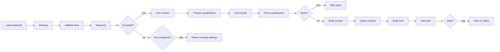

# Website lead intake for n8n (HubSpot + Claude)

An n8n workflow that receives contact form submissions from a website, rejects bad requests,
lets Claude qualify the lead, and saves it to HubSpot: the contact is created or updated, scored,
and gets a note with the summary. Hot leads are posted to Slack. Spam is not written anywhere.

## How it works



1. Lead webhook receives `POST /webhook/lead` with JSON or form fields.
2. Validate lead checks the shared secret, then cleans the form: known fields only, HTML and control
   characters removed, fixed length limits, email, phone and website checked, a hidden honeypot field
   for bots. Respond answers right away:

   | Case | Status | Body |
   |---|---|---|
   | accepted | 202 | `{"ok":true}` |
   | honeypot filled | 202 | `{"ok":true}` (the bot is not told) |
   | invalid fields | 400 | `{"ok":false,"errors":[...]}` |
   | wrong or missing secret | 401 | `{"ok":false,"error":"unauthorized"}` |
   | secret or business description not set in Settings | 500 | `{"ok":false,"error":"server not configured"}`, and the run fails |

3. Find contact looks the email up in HubSpot. Prepare qualification sends the form to Claude with the
   prompt in [`src/prompt.md`](src/prompt.md) and a description of the business from Settings. Claude
   returns a fit score from 0 to 100, an intent (buy, info, support, spam, job, partner), budget and
   timeline if the visitor stated them, a one-sentence summary and a suggested next step.
4. Parse qualification validates that reply. A failed call or anything malformed sets `needs_review`:
   the lead is still saved, without score or intent, and Slack is told it needs a look.
5. Spam ends at Skip spam, visible in the execution list but not written to HubSpot.
6. Everything else is upserted into HubSpot by email (form fields, score, intent, lifecycle stage), a
   note with the summary is added to the contact, and hot leads (intent buy and score at or above
   `hotScore`) or leads that need review are posted to Slack with a link to the contact.

The shared error workflow in [`shared/error-alert`](../../shared/error-alert) posts to Slack when a run fails outright.

## Setup (about 20 minutes)

1. In n8n: **Workflows → Import from file → `workflow.json`**.
2. In HubSpot, create a private app with the scopes `crm.objects.contacts.read` and
   `crm.objects.contacts.write`, and two contact properties: `ai_lead_score` (number) and
   `ai_lead_intent` (single-line text, or a dropdown with the values buy, info, support, job, partner).
   Other names work too; set them in Settings.
3. Create credentials and select them in the nodes:
   - HubSpot Service Key with the private app's access token (Find contact, Upsert contact, Add note)
   - Header Auth for Anthropic: name `x-api-key`, value your API key (Ask Claude)
   - Slack (Alert on Slack)
4. Fill in the Settings node (see [Configuration](#configuration)). At least `webhookSecret`,
   `businessDescription`, the portal ID in `hubspot.contactUrl` and `slackChannel`.
5. Import [`shared/error-alert/workflow.json`](../../shared/error-alert/workflow.json) as well, select the Slack credential and channel in it, and pick it under
   **Workflow settings → Error workflow** of this workflow.
6. Activate the workflow and point the form at the production URL, sending the secret in the
   `x-lead-secret` header. To try it:

   ```bash
   curl -i -X POST https://n8n.example.com/webhook/lead \
     -H 'content-type: application/json' -H 'x-lead-secret: <your secret>' \
     -d '{"name":"Test Lead","email":"test@example.com","message":"We need a new website."}'
   ```

## Configuration

Settings node:

| Key | Default | Notes |
|---|---|---|
| `webhookSecret` | placeholder | At least 16 characters. While it is the placeholder, every request gets a 500 and the run fails. |
| `secretHeader` | `x-lead-secret` | Header that carries the secret. |
| `secretQueryParam` | `''` | Set to e.g. `token` for form tools that cannot send headers; the secret then goes in the URL (`/webhook/lead?token=...`). Off by default because URLs end up in proxy and server logs. |
| `honeypotField` | `fax` | Hidden form field. Any value in it marks the request as a bot. |
| `fields` | see export | Accepted form field names per lead field, matched case-insensitively. Add the names your form uses. |
| `requiredFields` | `email`, `message` | |
| `model` | `claude-haiku-5-5` | The request turns thinking off, which Haiku 5.5 accepts. For other models, check `thinking` and `max_tokens` in `src/prepare-qualification.js`. |
| `businessDescription` | placeholder | What the business sells, to whom, typical project size, what it does not do. The score is only as good as this text. While it is the placeholder, every request gets a 500 and the run fails. |
| `hotScore` | `70` | Minimum fit score for a Slack alert (intent buy only). |
| `hubspot.scoreProperty`, `hubspot.intentProperty` | `ai_lead_score`, `ai_lead_intent` | Contact properties to write; `''` skips one. |
| `hubspot.hotLifecycleStage` | `marketingqualifiedlead` | Stage for hot leads. Other buy and info leads become `lead`. |
| `hubspot.contactUrl` | placeholder | `https://app.hubspot.com/contacts/<portal ID>/record/0-1/`; the contact ID is appended. EU accounts use `app-eu1.hubspot.com`. No link while it contains the placeholder. |
| `slackChannel` | `#sales-leads` | |
| `systemPrompt` | `src/prompt.md` | Edit the file and rebuild rather than the node, so the tests use the same text. |

Set in the code (`src/`, `build.mjs`): message limit 5,000 characters, name and company 200, phone
40, `max_tokens` 500, Claude timeout 60 s with up to 4 tries, HubSpot timeout 20 s with up to 3 tries.

## Design decisions

- Respond first, then work. The form gets its 202 before HubSpot or Claude are called, so a slow API
  never makes the visitor wait or the form tool retry. The price is that later failures cannot be
  reported to the form; they go to the error workflow instead.
- The secret is checked in a Code node, not with the Webhook node's Header Auth, so the 401 and 400
  answers come from one place and the check is covered by tests. It is compared in time that does not
  depend on how much of a guess was right. A secret only protects server-to-server posts: a plain HTML
  form that posts from the browser would expose it, and for those the honeypot and validation are the
  protection.
- Upsert by email instead of create-or-update by ID. Two submissions from the same person at the same
  time, or a contact the search index does not show yet, still end up as one contact. The search is
  kept to tell Claude whether the contact exists and to avoid moving the lifecycle stage backwards:
  stages only move forward, and custom or `other` stages are left alone.
- Form content is untrusted. Only configured fields are read, the phone number is not sent to Claude,
  and the form goes to Claude inside `<lead>` tags with any such tags removed from it. The parser does
  not rely on the prompt: score must be an integer from 0 to 100, intent one of six values, spam always
  scores 0, and a budget or timeline containing numbers the visitor did not write is dropped. Form text
  and the model's summary are HTML-escaped in the HubSpot note and Slack-escaped in the alert (no
  `<!channel>` pings or disguised links).
- Failures are visible. A failed Claude call saves the lead for review and says so on Slack. HubSpot
  calls retry and then fail the run, so the error workflow reports it with a link to the execution,
  which holds the submitted form. A batch response without a contact also fails the run in Build note
  instead of adding a note to nothing.

## Running in production

- Re-running a failed lead: use **Retry** on the failed execution, or copy the webhook input from it
  and post it again. Repeating the upsert is safe; a full second run adds a second note.
- Rate limits: HubSpot's search endpoint has a lower per-second limit than the other CRM endpoints.
  One search per form submission is far below it unless the form is flooded, and 429 answers are
  retried.
- Abuse: n8n has no rate limit on webhooks. Requests without the secret stop at Validate lead, but if
  the secret is in a browser form, every submission that passes validation costs a Claude call. Put
  the webhook behind a reverse proxy with a rate limit in that case, or add a captcha to the form.
- Data: execution logs contain the form content. Set `EXECUTIONS_DATA_SAVE_ON_SUCCESS=none` or prune
  with `EXECUTIONS_DATA_PRUNE=true` and `EXECUTIONS_DATA_MAX_AGE`. Form content is sent to Anthropic
  and HubSpot, so the privacy notice on the form and the customer's data processing agreements need to
  cover both.
- Credentials: n8n stores them encrypted with `N8N_ENCRYPTION_KEY`. The webhook secret is part of the
  workflow, so anyone who can open the workflow can read it.

## Limits

- Only flat bodies are read. Form tools that nest fields or send answers as an array need a Set or
  Code node in front of Validate lead that flattens them.
- Webhook signatures (Typeform, Webflow and others sign their requests) are not verified; the shared
  secret is the only authentication.
- If the search has not indexed a contact created seconds earlier, its lifecycle stage is unknown and
  the workflow may try to set `lead` on it.
- Spam detection depends on the model. A real lead classified as spam is only visible in the
  execution list (Skip spam), not in HubSpot.
- Prompt injection is mitigated, not ruled out: a form can still push its own score up. It cannot get
  unescaped text into HubSpot or Slack, change where data is written, or make up a budget.
- The Slack alert waits for the note. If Add note fails after its retries, the run fails before the
  alert and the error workflow reports it instead.

## Tests

`npm test` (from the repository root) runs the Code node sources outside n8n with mocked `$input` and
`$()`: secret check, validation and normalisation, the request to Claude, validation of its reply,
the HubSpot upsert and note, Slack text escaping. It also checks the export: in sync with `src/`,
retry and error settings on every HTTP node, spam never reaching HubSpot.

`npm run check:n8n -- lead-intake` imports the workflow into n8n 2.43 (Docker) and runs the cases in
[`test/n8n.cases.mjs`](test/n8n.cases.mjs): a hot lead from a new contact, an existing customer who is
updated without losing their lifecycle stage, a filled honeypot, a wrong secret, the placeholder settings,
an invalid form, spam, a failed Claude call, and HubSpot rejecting the contact. HubSpot and Claude are
answered by a local mock with responses shaped like their API documentation; the workflow has not been
run against a live HubSpot account from this repository.

## Files

| Path | Purpose |
|---|---|
| `workflow.json` | the workflow to import (generated by `build.mjs`) |
| `build.mjs` | builds `workflow.json` from `src/` |
| `src/prompt.md` | system prompt for Claude |
| `src/validate-lead.js` | Code node: secret check, validation, normalisation, HTTP response |
| `src/prepare-qualification.js` | Code node: combine lead and HubSpot search, build the Claude request |
| `src/parse-qualification.js` | Code node: validate the AI reply |
| `src/build-contact.js` | Code node: HubSpot upsert with score, intent and lifecycle stage |
| `src/build-note.js` | Code node: check the upsert, build the note and the Slack text |
| `test/` | unit tests, structural checks and the n8n run cases |
