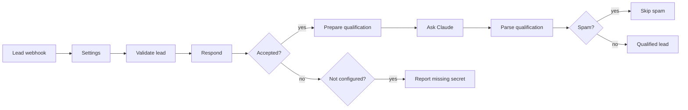

# Website lead intake for n8n

An n8n workflow that receives contact form submissions from a website, rejects bad requests, and
lets Claude qualify each lead: fit score, intent, budget and timeline if stated, a summary and a
suggested next step. Spam is set apart.

## How it works



1. Lead webhook receives `POST /webhook/lead` with JSON or form fields.
2. Validate lead checks the shared secret, then cleans the form: known fields only, HTML and control
   characters removed, fixed length limits, email, phone and website checked, a hidden honeypot field
   for bots. Respond answers right away:

   | Case | Status | Body |
   |---|---|---|
   | accepted | 202 | `{"ok":true}` |
   | honeypot filled | 202 | `{"ok":true}` (the bot is not told) |
   | invalid fields | 400 | `{"ok":false,"errors":[...]}` |
   | wrong or missing secret | 401 | `{"ok":false,"error":"unauthorized"}` |
   | secret not set in Settings | 500 | `{"ok":false,"error":"server not configured"}`, and the run fails |

3. Prepare qualification sends the form to Claude with the prompt in [`src/prompt.md`](src/prompt.md)
   and a description of the business from Settings. Claude returns a fit score from 0 to 100, an
   intent (buy, info, support, spam, job, partner), budget and timeline if the visitor stated them, a
   one-sentence summary and a suggested next step.
4. Parse qualification validates that reply. A failed call or anything malformed sets `needs_review`
   and leaves score and intent empty, so the lead is not lost. A lead is hot when the intent is buy
   and the score is at or above `hotScore`.
5. Spam ends at Skip spam; everything else at Qualified lead, with the result in the execution data.

The shared error workflow in [`shared/error-alert`](../../shared/error-alert) posts to Slack when a run fails outright.

## Setup

1. In n8n: **Workflows → Import from file → `workflow.json`**.
2. Create a Header Auth credential for Anthropic (name `x-api-key`, value your API key) and select it
   in Ask Claude.
3. Fill in the Settings node (see [Configuration](#configuration)), at least `webhookSecret` and
   `businessDescription`.
4. Import [`shared/error-alert/workflow.json`](../../shared/error-alert/workflow.json) as well, select the Slack credential and channel in it, and pick it under
   **Workflow settings → Error workflow** of this workflow.
5. Activate the workflow and point the form at the production URL, sending the secret in the
   `x-lead-secret` header. To try it:

   ```bash
   curl -i -X POST https://n8n.example.com/webhook/lead \
     -H 'content-type: application/json' -H 'x-lead-secret: <your secret>' \
     -d '{"name":"Test Lead","email":"test@example.com","message":"We need a new website."}'
   ```

## Configuration

Settings node:

| Key | Default | Notes |
|---|---|---|
| `webhookSecret` | placeholder | At least 16 characters. While it is the placeholder, every request gets a 500 and the run fails. |
| `secretHeader` | `x-lead-secret` | Header that carries the secret. |
| `secretQueryParam` | `''` | Set to e.g. `token` for form tools that cannot send headers; the secret then goes in the URL (`/webhook/lead?token=...`). Off by default because URLs end up in proxy and server logs. |
| `honeypotField` | `fax` | Hidden form field. Any value in it marks the request as a bot. |
| `fields` | see export | Accepted form field names per lead field, matched case-insensitively. Add the names your form uses. |
| `requiredFields` | `email`, `message` | |
| `model` | `claude-haiku-5-5` | The request turns thinking off, which Haiku 5.5 accepts. For other models, check `thinking` and `max_tokens` in `src/prepare-qualification.js`. |
| `businessDescription` | placeholder | What the business sells, to whom, typical project size, what it does not do. The score is only as good as this text. |
| `hotScore` | `70` | Minimum fit score for a hot lead (intent buy only). |
| `systemPrompt` | `src/prompt.md` | Edit the file and rebuild rather than the node, so the tests use the same text. |

Set in the code (`src/`, `build.mjs`): message limit 5,000 characters, name and company 200, phone
40, `max_tokens` 500, Claude timeout 60 s with up to 4 tries.

## Tests

`npm test` (from the repository root) runs the Code node sources outside n8n with mocked `$input` and
`$()`: secret check, validation and normalisation, the request to Claude, validation of its reply. It
also checks the export: in sync with `src/`, retry and error settings on Ask Claude, spam routing.

`npm run check:n8n -- lead-intake` imports the workflow into n8n 2.43 (Docker) and runs the cases in
[`test/n8n.cases.mjs`](test/n8n.cases.mjs), with Claude answered by a local mock.

## Files

| Path | Purpose |
|---|---|
| `workflow.json` | the workflow to import (generated by `build.mjs`) |
| `build.mjs` | builds `workflow.json` from `src/` |
| `src/prompt.md` | system prompt for Claude |
| `src/validate-lead.js` | Code node: secret check, validation, normalisation, HTTP response |
| `src/prepare-qualification.js` | Code node: build the Claude request |
| `src/parse-qualification.js` | Code node: validate the AI reply |
| `test/` | unit tests, structural checks and the n8n run cases |
