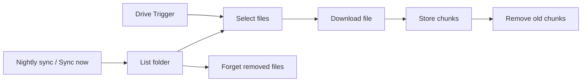

# Support chatbot over your own documents (n8n, Claude, pgvector)

Work in progress. This first part, `ingest.json`, keeps a Postgres table (pgvector) in sync with a
Google Drive folder: new and changed files are split into chunks and embedded with OpenAI, removed
files are forgotten. The chat that searches those chunks follows.

## How it works

1. Drive Trigger checks the folder every 10 minutes for new or changed files. Nightly sync (3:00)
   and Sync now list the whole folder instead, for the first load and to catch deletions.
2. Select files keeps Google Docs, PDF, Word (.docx), Markdown and plain text files up to 10 MB.
3. Download file exports Google Docs as Markdown and downloads the others.
4. Store chunks splits each file into chunks of about 1,000 characters (150 overlap), embeds them
   with `text-embedding-3-small` and writes them to `support_chunks`, each with `file_id`,
   `file_name`, `source_url` and the id of the run that stored it.
5. Remove old chunks then deletes the chunks those files had from earlier runs. Forget removed
   files (full sync only) deletes chunks of files that are no longer in the folder.

## Setup

1. A Postgres database with the pgvector extension. Run [`src/setup.sql`](src/setup.sql) once in it.
2. Import `ingest.json`, create Postgres, OpenAI and Google Drive OAuth2 credentials and select them
   in the nodes.
3. Put the Drive folder ID into Drive Trigger and List folder, run **Sync now** once, then activate.

## Files

| Path | Purpose |
|---|---|
| `ingest.json` | the workflow to import (generated by `build.mjs`) |
| `build.mjs` | builds the export from `src/` |
| `src/setup.sql` | table and index, run once |
| `src/select-files.js` | Code node: pick readable Drive files, clean names |
| `test/` | unit tests, structural checks, n8n run cases and the embeddings mock |
