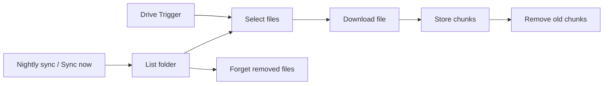
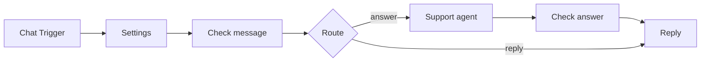

# Support chatbot over your own documents (n8n, Claude, pgvector)

A chat widget for a company website that answers customer questions from the company's own
documents in a Google Drive folder and cites the file it took the answer from. Work in progress:
handing questions to a person and rate limits follow.

- `ingest.json` keeps a Postgres table (pgvector) in sync with the Drive folder: new and changed
  files are split into chunks and embedded with OpenAI, removed files are forgotten.
- `chat.json` is the chat: an AI Agent with Claude that searches those chunks and remembers the
  conversation per session.

## How it works

1. Drive Trigger checks the folder every 10 minutes for new or changed files. Nightly sync (3:00)
   and Sync now list the whole folder instead, for the first load and to catch deletions.
2. Select files keeps Google Docs, PDF, Word (.docx), Markdown and plain text files up to 10 MB.
3. Download file exports Google Docs as Markdown and downloads the others.
4. Store chunks splits each file into chunks of about 1,000 characters (150 overlap), embeds them
   with `text-embedding-3-small` and writes them to `support_chunks`, each with `file_id`,
   `file_name`, `source_url` and the id of the run that stored it.
5. Remove old chunks then deletes the chunks those files had from earlier runs. Forget removed
   files (full sync only) deletes chunks of files that are no longer in the folder.

1. Chat Trigger receives the message from the website widget.
2. Check message answers empty or over-long messages with a fixed reply; everything else goes to
   the agent inside `<customer_message>` tags.
3. Support agent (Claude Haiku 5.5) searches the documents with the `search_documents` tool and
   answers with the prompt in [`src/system-prompt.md`](src/system-prompt.md), or replies `HANDOFF:`
   when the documents do not contain the answer. Chat memory keeps the last turns per session.
4. Check answer only lets an answer through if it cites a file the search actually returned, and
   adds the links to those files itself. Anything else gets the contact address from Settings.

## Setup

1. A Postgres database with the pgvector extension. Run [`src/setup.sql`](src/setup.sql) once in it.
2. Import `ingest.json` and `chat.json`, create Postgres, OpenAI, Anthropic and Google Drive OAuth2
   credentials and select them in the nodes.
3. Put the Drive folder ID into Drive Trigger and List folder, run **Sync now** once, then activate.
4. In `chat.json`, fill in the Settings node, set **Allowed origins** in the Chat Trigger to the
   website's address, and activate it.

## Files

| Path | Purpose |
|---|---|
| `ingest.json`, `chat.json` | the workflows to import (generated by `build.mjs`) |
| `build.mjs` | builds both exports from `src/` |
| `src/setup.sql` | table and index, run once |
| `src/system-prompt.md` | system prompt for the agent |
| `src/select-files.js` | Code node: pick readable Drive files, clean names |
| `src/check-message.js` | Code node: length cap, routing |
| `src/check-answer.js` | Code node: validate citations, add source links |
| `test/` | unit tests, structural checks, n8n run cases and the API mock |
