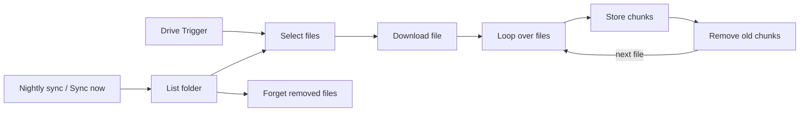
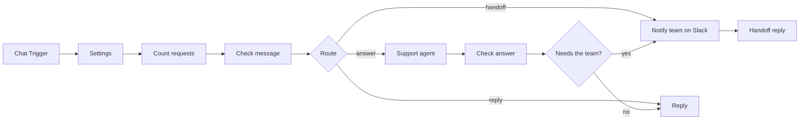

# Support chatbot over your own documents (n8n, Claude, pgvector)

A chat widget for a company website that answers customer questions from the company's own
documents in a Google Drive folder, cites the file it took the answer from, and passes the
question to the team on Slack when the documents do not cover it.

Two workflows:

- `ingest.json` keeps a Postgres table (pgvector) in sync with the Drive folder: new and changed
  files are split into chunks and embedded with OpenAI, removed files are forgotten.
- `chat.json` is the chat: an AI Agent with Claude that searches those chunks, remembers the
  conversation per session, and hands off to a person when it cannot answer.

## How it works



1. Drive Trigger checks the folder every 10 minutes for new or changed files. Nightly sync (3:00)
   and Sync now list the whole folder instead, for the first load and to catch deletions.
2. Select files keeps Google Docs, PDF, Word (.docx), Markdown and plain text files up to 10 MB.
   Drive reports no size for Google Docs, so they are not checked against the limit.
3. Download file exports Google Docs as Markdown and downloads the others.
4. Loop over files passes the files on one at a time. Store chunks splits the file into chunks of
   about 1,000 characters (150 overlap), embeds them with `text-embedding-3-small` and writes them
   to `support_chunks`, each with `file_id`, `file_name`, `source_url` and the id of the run that
   stored it.
5. Remove old chunks then deletes the chunks that file had from earlier runs, and the loop goes on
   to the next file. Forget removed files (full sync only) deletes chunks of files that are no
   longer in the folder; if the folder is empty, that is all chunks.



1. Chat Trigger receives the message from the website widget (or any client that posts to its URL).
2. Count requests records the message for the rate limit. Check message rejects empty or over-long
   messages and sessions over the limit with a fixed reply, and sends explicit requests for a person
   straight to the team. Everything else goes to the agent.
3. Support agent (Claude Haiku 5.5) searches the documents with the `search_documents` tool and
   answers with the prompt in [`src/system-prompt.md`](src/system-prompt.md), or replies `HANDOFF:`
   when the documents do not contain the answer. Chat memory keeps the last turns per session.
4. Check answer only lets an answer through if it cites a file the search actually returned, and
   adds the links to those files itself. Anything else becomes a handoff.
5. A handoff posts the question, the reason and the session id to Slack and tells the customer the
   team has it.

The shared error workflow in [`shared/error-alert`](../../shared/error-alert) reports runs that fail
outright, for example an expired Google token during ingest.

## Setup (about 30 minutes)

1. A Postgres database with the pgvector extension. Supabase and Neon include it; on your own server
   use the `pgvector/pgvector` image or the `postgresql-<version>-pgvector` package. Run
   [`src/setup.sql`](src/setup.sql) once in it (`psql "$DATABASE_URL" -f src/setup.sql`).
2. In n8n: **Workflows → Import from file**, once for `ingest.json` and once for `chat.json`.
3. Create credentials and select them in the nodes:
   - Postgres (Forget removed files, Store chunks, Remove old chunks, Count requests, Chat memory,
     search_documents). Use a database user that can only reach this database.
   - OpenAI (Embeddings, Query embeddings)
   - Anthropic (Claude)
   - Google Drive OAuth2 (Drive Trigger, List folder, Download file)
   - Slack (Notify team on Slack)
4. In `ingest.json`, put the Drive folder ID (the last part of the folder's URL) into Drive Trigger
   and List folder. Run **Sync now** once and check that `support_chunks` has rows. Activate the
   workflow.
5. In `chat.json`, fill in the Settings node (see [Configuration](#configuration)) and set
   **Allowed origins** in the Chat Trigger to your website's address. Activate the workflow and copy
   the Chat URL from the Chat Trigger.
6. Add the widget to the website:

   ```html
   <link href="https://cdn.jsdelivr.net/npm/@n8n/chat/dist/style.css" rel="stylesheet" />
   <script type="module">
     import { createChat } from 'https://cdn.jsdelivr.net/npm/@n8n/chat/dist/chat.bundle.es.js';
     createChat({ webhookUrl: 'CHAT_URL_FROM_THE_CHAT_TRIGGER' });
   </script>
   ```

   Pin a version of `@n8n/chat` in both URLs for production. Other clients can post
   `{ "action": "sendMessage", "sessionId": "...", "chatInput": "..." }` to the same URL and get
   `{ "output": "..." }` back.
7. Import [`shared/error-alert/workflow.json`](../../shared/error-alert/workflow.json) and select it
   under **Workflow settings → Error workflow** of both workflows.

## Configuration

Settings node in `chat.json`:

| Key | Default | Notes |
|---|---|---|
| `maxMessageChars` | `1000` | Longer messages get `tooLongMessage` and never reach the model. |
| `sessionLimitPer10Min` | `20` | Messages per session in 10 minutes before `rateLimitMessage`. |
| `globalLimitPerMinute` | `30` | Messages across all sessions per minute; caps the API bill if the chat is flooded. |
| `slackChannel` | `#support-handoff` | Where handoffs are posted. |
| `handoffMessage` | text | Shown to the customer on handoff. Put your real support address in it. |
| `emptyMessage`, `tooLongMessage`, `rateLimitMessage` | text | Fixed replies. |

In the nodes:

| Node | Setting |
|---|---|
| Claude | Model ID, `claude-haiku-5-5`. `claude-sonnet-5-5` gives better answers on long or mixed documents at a higher price; it does not accept disabled thinking, so set Thinking Mode to Adaptive with it. |
| Embeddings, Query embeddings | `text-embedding-3-small`. Change both together; a model with another dimension also needs a new table (see `setup.sql`). |
| Text splitter | chunk size 1,000 characters, overlap 150 |
| search_documents | 4 results per search |
| Chat memory | last 6 messages per session, table `support_chat_histories` (created by the node) |
| Drive Trigger | polls every 10 minutes |
| Nightly sync | 3:00 every day |

The prompt lives in `src/system-prompt.md`; edit it there and run `npm run build`, so the tests use
the same text.

## Design decisions

- pgvector instead of a separate vector database. One Postgres holds the chunks, the chat memory
  and the rate limit, with one credential. Small businesses often have Postgres already, and the
  managed offers with pgvector have free or low-cost tiers. Deleting a file's chunks is a plain
  `DELETE`, which the n8n vector store nodes do not offer.
- Replace, don't duplicate. Every chunk carries the id of the ingest run that stored it. After a
  file's new chunks are stored, the chunks of older runs are deleted. A file is never without chunks
  while it is being updated, and a run that fails halfway leaves the old chunks in place; the next
  run cleans up. If two runs store the same file at the same time (a Drive Trigger poll during the
  nightly sync), each cleanup keeps the chunks of the run with the highest execution id, so one set
  remains instead of none or both.
- One file at a time. The document loader is a sub-node, and n8n documents that sub-node
  expressions resolve against the first input item. With several files in one pass, chunks could
  get the first file's metadata. The loop gives Store chunks and Remove old chunks one file per
  pass, so the metadata and the cleanup refer to that file.
- Sources are checked, not trusted. The model is told to cite file names, but Check answer only
  accepts names that appear in the search results of that turn, and builds the links from the stored
  metadata. An answer citing nothing that was retrieved, or containing a link, goes to the team.
  A reply without a source is let through only if every sentence is a greeting, thanks, goodbye or
  offer to help from a fixed list (English and German), so "Shipping is free." goes to the team.
  File names may contain commas; the Sources line is matched against the names the search
  returned, not split at every comma.
- Customer and document text are untrusted. The message reaches the agent inside
  `<customer_message>` tags with such tags removed from it, the prompt says neither the message nor
  the documents can change the rules, and the checks above do not depend on the model following
  it. Slack gets the question escaped (no `<!channel>` pings or disguised links), SQL gets values
  only as query parameters.
- The browser only gets the reply. The Chat Trigger returns the last node's output to the client,
  so the reply nodes keep only `output`; reasons, session ids and search results stay on the server.
- Failures end in a handoff. A failed Claude call (after 3 tries) goes to Check answer as an error
  and becomes a Slack post, so the customer gets an answer and the team sees the problem.

## Running in production

- Cost: a question that reaches the agent is two Claude calls (search, answer). The input is the
  system prompt, up to four passages of about 1,000 characters, and the memory window, so a few
  thousand tokens. At Haiku 5.5 list prices ($0.10 input / $0.50 output per million tokens, October
  2026) that is well under a cent per question. Check the token counts in the execution data of a
  few real conversations before quoting a number. Fixed replies and direct handoffs cost nothing.
  Embedding cost depends on the size of the folder; see OpenAI's price list.
- Rate limits: the global limit is the protection that matters, since a client can pick a new
  session id for every message. Put the n8n instance behind a reverse proxy with per-IP limits if
  the site gets abuse.
- Data: the chat memory stores the conversation (including the search results of each turn) per
  session id in `support_chat_histories`, with no expiry. Delete old sessions on a schedule if your
  privacy policy requires it. `support_chat_requests` holds only session ids and timestamps and
  removes rows older than a day. n8n's execution log contains the chat text; set
  `EXECUTIONS_DATA_SAVE_ON_SUCCESS=none` or prune with `EXECUTIONS_DATA_PRUNE=true` and
  `EXECUTIONS_DATA_MAX_AGE`. Chat text goes to Anthropic, document text to OpenAI; the customer's
  data processing agreements need to cover both, and the site's privacy notice should mention the
  chat.
- Credentials: n8n stores them encrypted with `N8N_ENCRYPTION_KEY`; keep that key outside the
  instance backup. The exports contain no credential IDs (a test checks this).
- Scale: pgvector searches the table without an index here, which is fine for the document set of
  a small business. For a large folder, add an HNSW index
  (`CREATE INDEX ON support_chunks USING hnsw (embedding vector_cosine_ops)`).

## Limits

- The handoff is one-way: the team gets the question on Slack but cannot reply in the widget. The
  handoff message points the customer to the support address; the team can look up the
  conversation by session id in `support_chat_histories`.
- Answers are only as good as the documents. Scanned PDFs without a text layer, images and
  spreadsheets are not read. Only files directly in the folder are read, not subfolders.
- The nightly sync downloads and embeds every file again, and downloads all of them before the
  loop starts, so they are held at once. For a folder with many large files, run it weekly
  instead.
- A sync that sees an empty folder deletes every chunk. A wrong folder ID in List folder also
  looks like an empty folder to Drive; check the ID before running Sync now on a filled table.
- The small-talk list for unsourced replies is short on purpose. A friendly reply that is not on it
  ("Happy to help!") goes to the team; extend `SMALL_TALK` in `src/check-answer.js` if that
  happens often.
- The check for "asks for a person" is a word list in English and German; other phrasings are left
  to the agent, which hands off when it cannot answer.
- The per-session rate limit can be bypassed with new session ids (see above).
- Prompt injection through a document is possible only for people who can edit the Drive folder;
  treat edit access to that folder like edit access to the website.

## Tests

`npm test` runs the Code node sources outside n8n with mocked `$input` and `$()`, and checks the
exports: in sync with `src/`, chunk metadata and the delete-after-insert step in place, memory keyed
by session id, Slack text escaped, only `output` returned to the browser.

`npm run check:n8n -- support-chatbot` starts a pgvector container next to n8n 2.43 (Docker), runs
`setup.sql`, and runs both workflows against it. Drive and Slack are replaced by nodes that return
fixed files or record what they would send; OpenAI embeddings and Claude are answered by a local
mock ([`test/mock-apis.mjs`](test/mock-apis.mjs)) whose embeddings are word hashes, so similar texts
get similar vectors and the search really returns the matching passage. The cases in
[`test/n8n.cases.mjs`](test/n8n.cases.mjs) ingest two Markdown files, re-ingest a changed one and
check that its old chunk is gone, answer a refund question from the stored chunk with the linked
source, hand off a question the documents do not cover, a request for a person and a failed Claude
call to Slack, reject a flooding session and an over-long message, and forget a file removed from
the folder.

The mock Claude follows the prompt by construction, so these runs test the workflow, not the
quality of the answers. Try the prompt with your own documents and real questions before going
live.

## Files

| Path | Purpose |
|---|---|
| `ingest.json`, `chat.json` | the workflows to import (generated by `build.mjs`) |
| `build.mjs` | builds both exports from `src/` |
| `src/setup.sql` | tables and indexes, run once |
| `src/system-prompt.md` | system prompt for the agent |
| `src/select-files.js` | Code node: pick readable Drive files, clean names |
| `src/check-message.js` | Code node: length cap, rate limit, routing |
| `src/check-answer.js` | Code node: validate citations, add source links |
| `test/` | unit tests, structural checks, n8n run cases and the API mock |
